# UI flow design

The flow was drawn in FigJam: [Workshop Hub UI Flow](https://www.figma.com/board/TRanVeLfSBu3qw5tIWRsZA). The screenshots below are from the finished app.

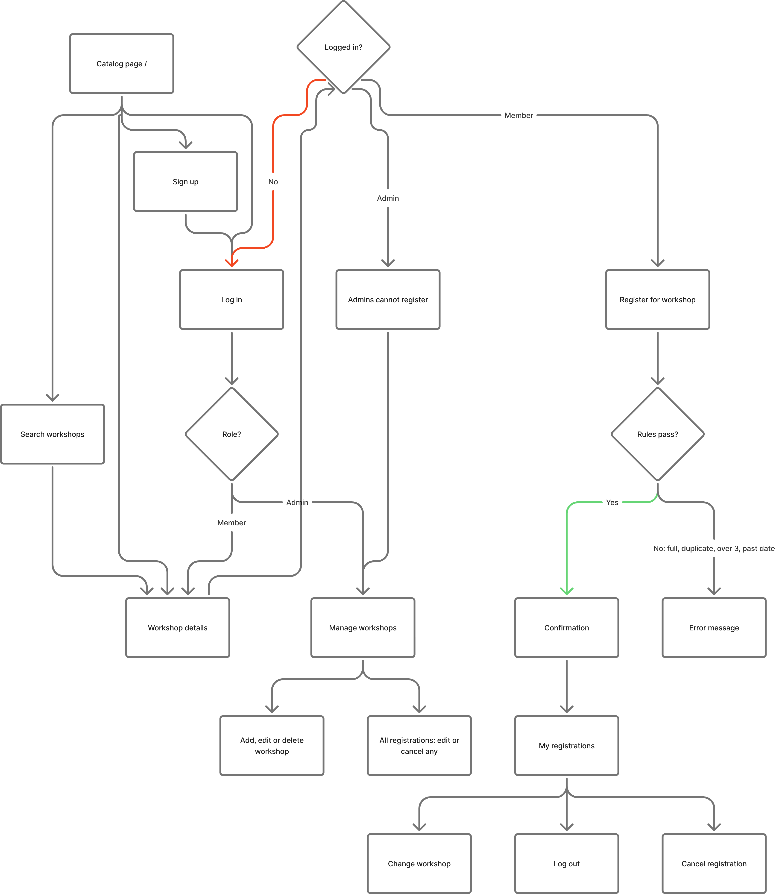

## Pages

| Page | Who can open it | Purpose |
|---|---|---|
| `/` | Everyone | Workshop catalog with search |
| `/workshops/[id]` | Everyone | Details and the register action |
| `/login`, `/register` | Visitors | Authentication |
| `/registrations` | Logged in | Members see their own registrations, admins see all |
| `/admin/workshops` | Admin | Add, edit and delete workshops |

## Main flow

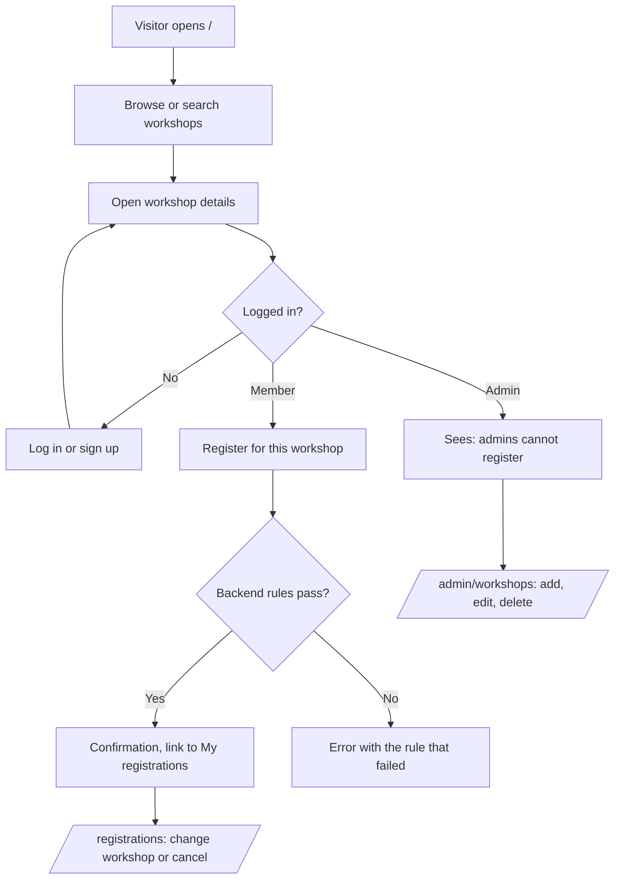

## Registration rules and what the user sees

| Rule | What happens |
|---|---|
| Workshop is full | Red alert on the workshop page: the backend message |
| Already registered for it | Red alert with the backend message |
| More than 3 active workshops | Red alert with the backend message |
| Workshop date has passed | The register button is replaced by "registration is closed" |
| Not logged in | Prompt linking to login, then back to the same workshop |

## Screens

1. **Catalog**: search bar, result count, cards with date, seats, instructor and location, an Open or Ended badge.
2. **Workshop details**: full description, facts, one clear action depending on role.
3. **Login and Sign up**: inline validation (phone, password length, matching passwords), errors in an alert region.
4. **My registrations**: card per registration, Active or History badge, "Change workshop" opens an inline selector, "Cancel registration" asks to confirm.
5. **Admin workshops**: one form used for both add and edit, a list below with Edit and Delete.

## States covered

Loading skeletons, empty lists, backend errors, network errors, not found, forbidden (non-admin on the admin page), expired or missing session (redirect to login with a return URL).

## Screenshots

| | |
|---|---|
| 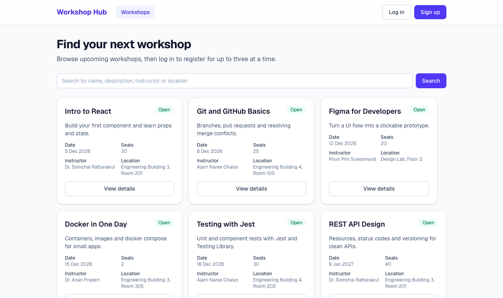 Catalog | 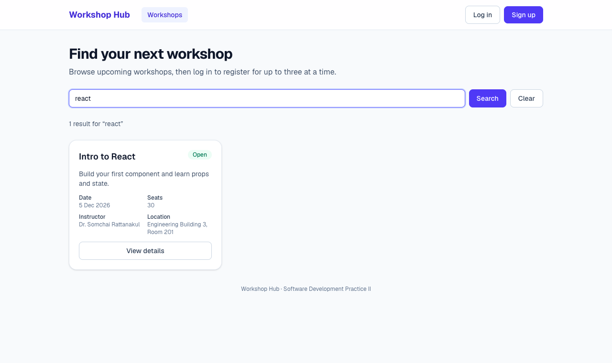 Search |
| 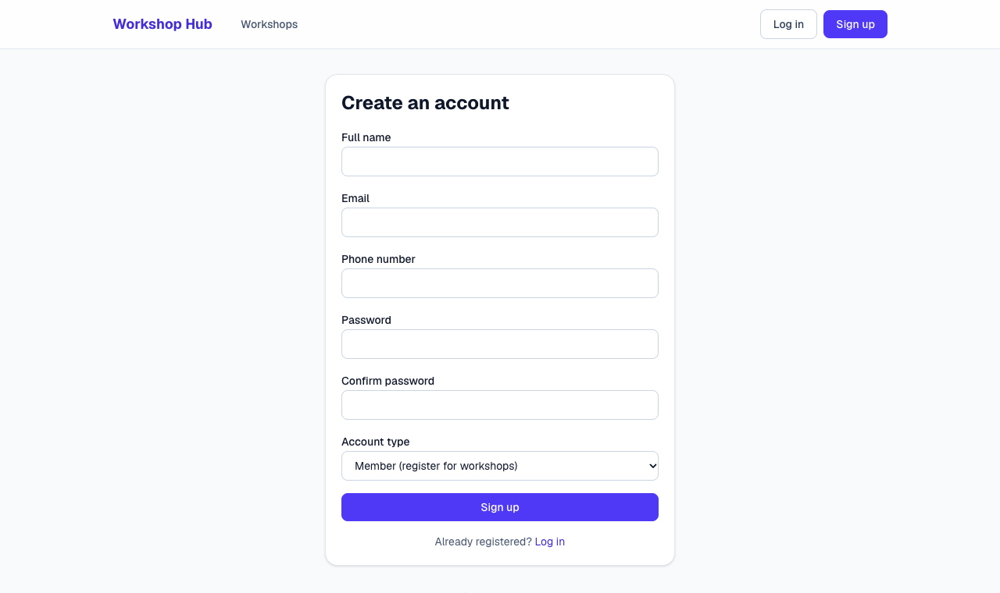 Sign up | 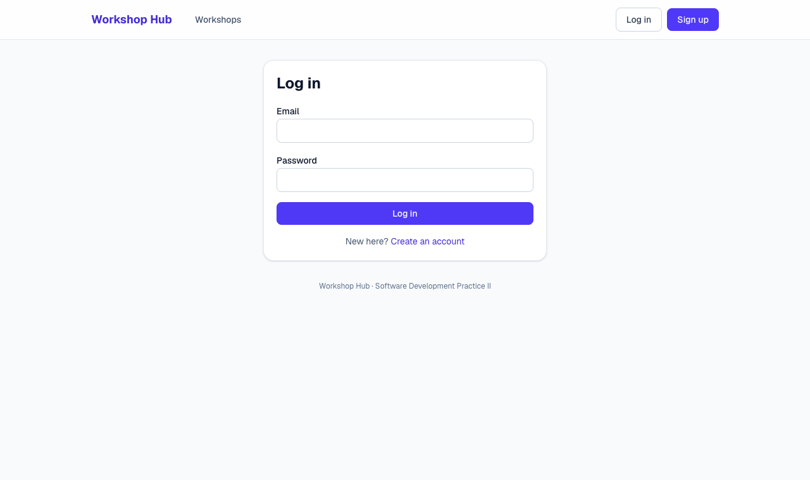 Log in |
| 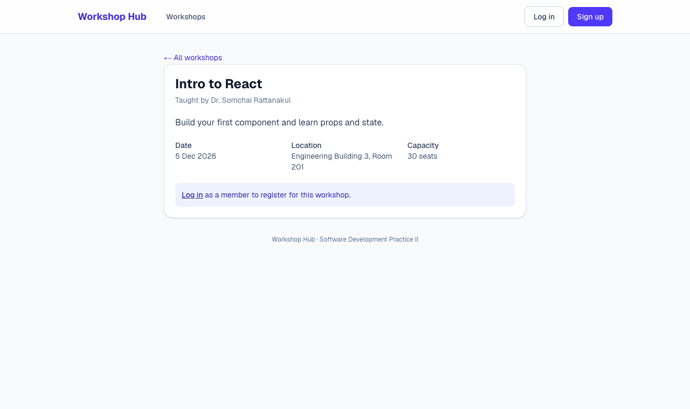 Details as a visitor | 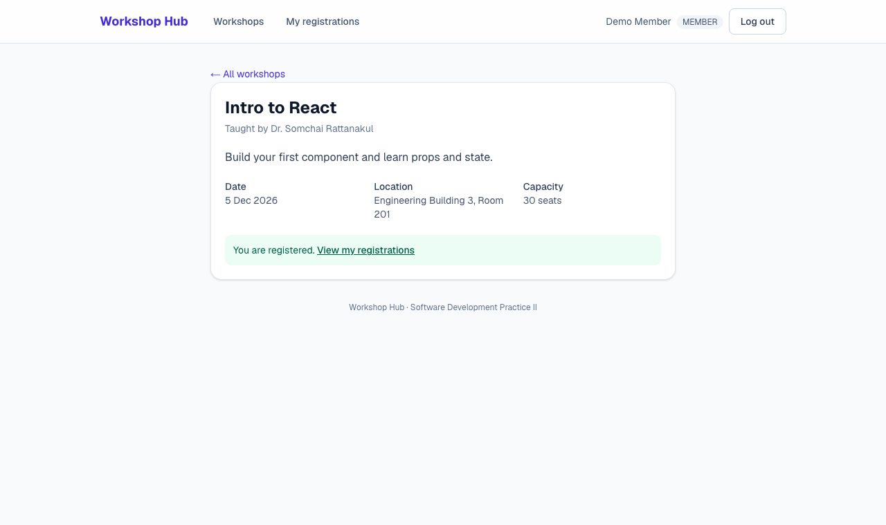 Registered |
| 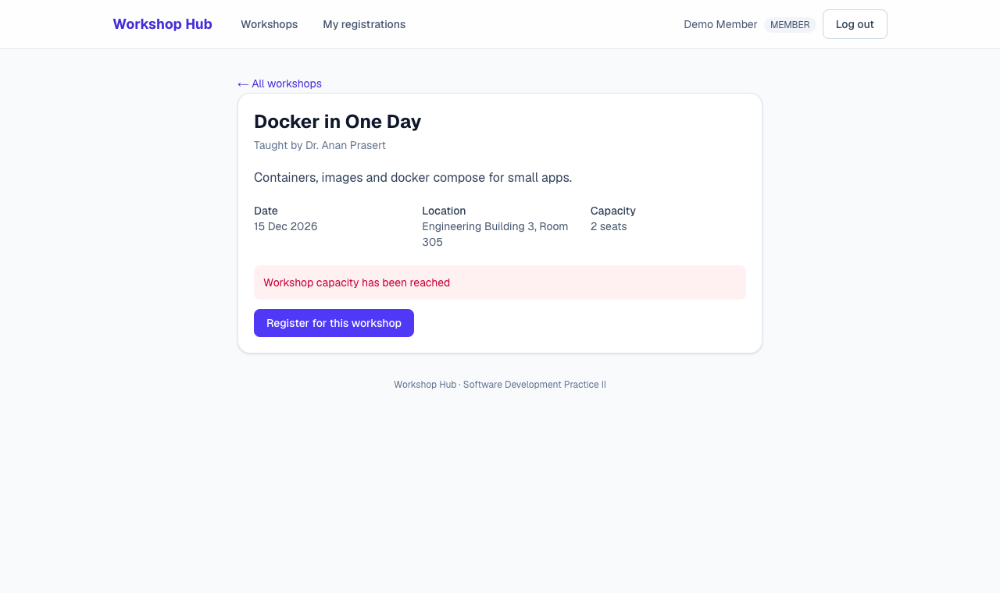 Workshop full | 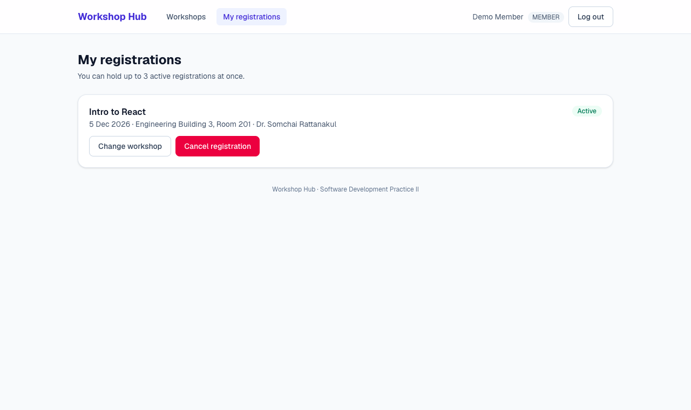 My registrations |
| 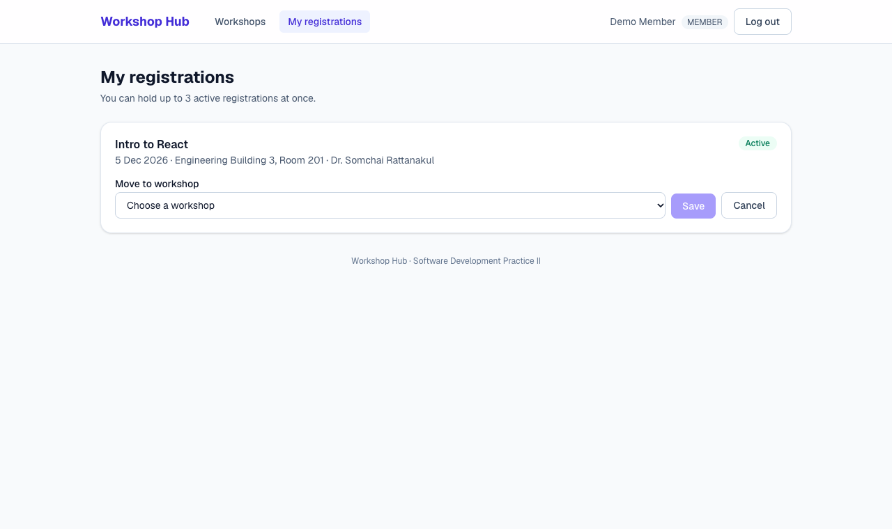 Change workshop | 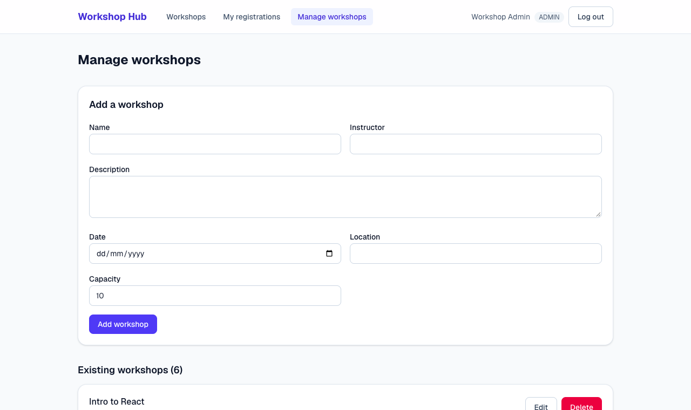 Admin workshops |
| 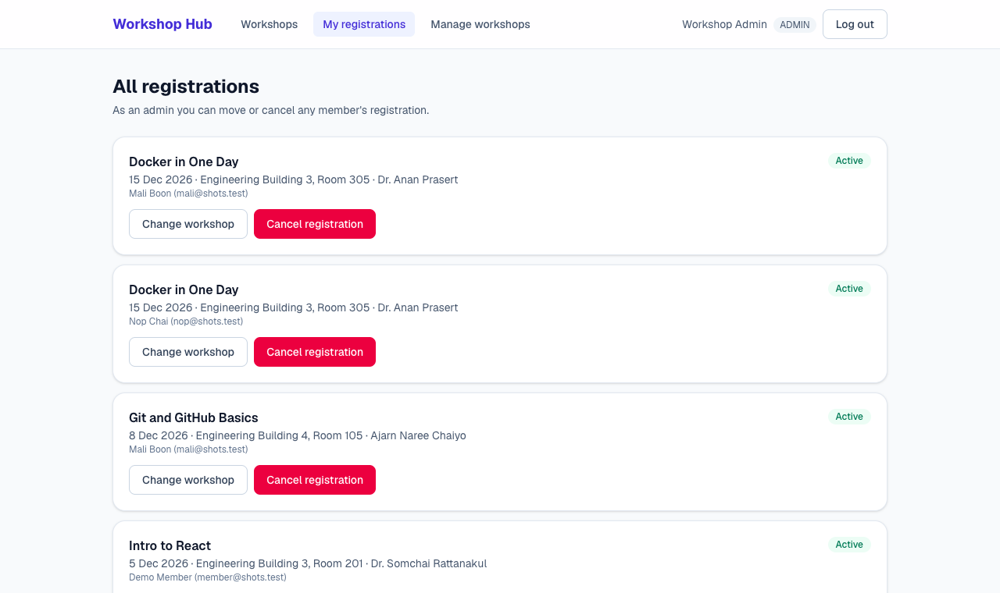 Admin sees all registrations | |
